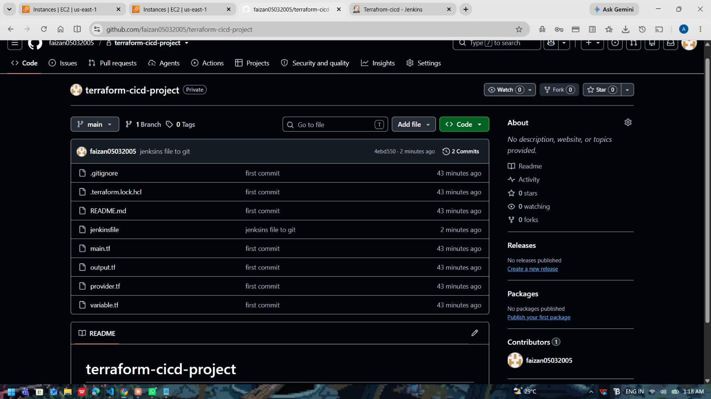
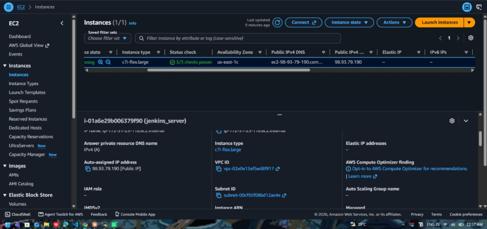
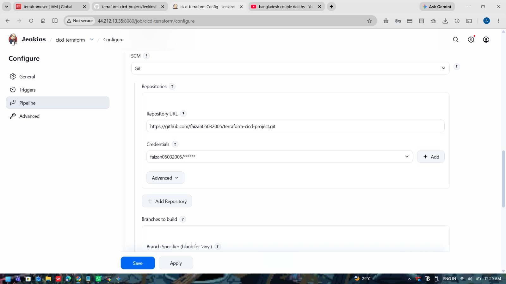
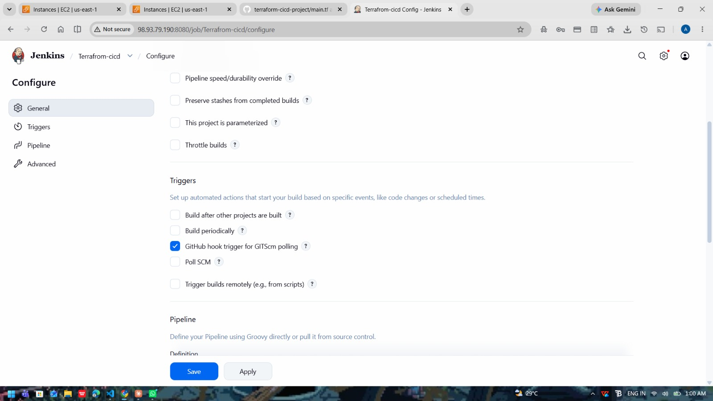
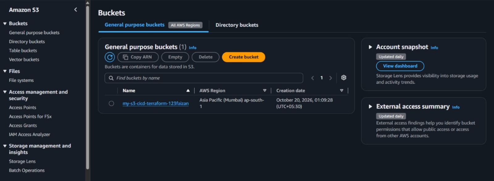

# Terraform + Jenkins CI/CD: Automated S3 Bucket Deployment on AWS

A CI/CD pipeline that pulls Terraform code from GitHub and deploys an AWS S3 bucket automatically using Jenkins running on an EC2 instance.

## Architecture

```
Developer (VS Code) --git push--> GitHub --webhook--> Jenkins (EC2) --terraform--> AWS S3 (ap-south-1)
```

## Tools Used

- Terraform (Infrastructure as Code)
- Jenkins (CI/CD, declarative pipeline)
- GitHub (source control + webhook trigger)
- AWS EC2 (Jenkins server), IAM (dedicated `terrafromuser`), S3 (deployed resource)

## Repository Structure

| File | Purpose |
|------|---------|
| `main.tf` | S3 bucket resource and tags |
| `variable.tf` | Input variables (bucket name, region) |
| `provider.tf` | AWS provider and Terraform version |
| `output.tf` | Outputs the bucket name |
| `Jenkinsfile` | Pipeline: checkout, init, validate, plan, approval, apply |

## Pipeline Stages

1. Checkout code from GitHub
2. Verify tools (terraform, aws cli)
3. Terraform init
4. Format check and validate
5. Terraform plan (saved to `tfplan`)
6. Manual approval
7. Terraform apply of the saved plan

## Security

- AWS keys are stored in the Jenkins credentials store, never in code or Git.
- IAM user is used only by Jenkins (S3 permissions).
- `.terraform/` and `*.tfstate` are excluded via `.gitignore`.

## Proof of Work

### 1. GitHub repository


### 2. Jenkins server on EC2


### 3. Jenkins pipeline connected to GitHub


### 4. GitHub webhook trigger


### 5. Pipeline run: all stages green


### 7. S3 bucket created in AWS


## What I Learned / Issues Fixed

- S3 bucket names cannot contain underscores. The error appeared at apply time and was fixed by using hyphens.
- Jenkins must read AWS credentials from its own credentials store (or run as the same user that ran `aws configure`).
- Always apply the saved plan file so exactly what was reviewed is what gets deployed.

## Future Improvements

- Remote state in S3 with locking
- Bucket versioning, encryption and public access block
- tflint and checkov security scans
- Separate dev and prod environments
